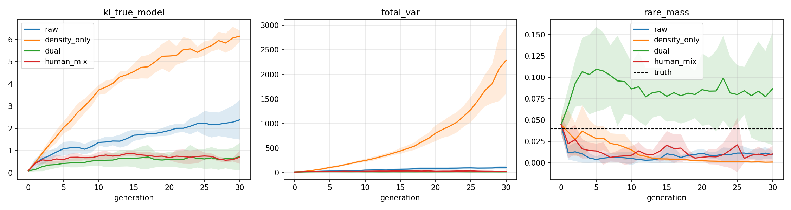

# Yinelemeli LLM Eğitiminde Model Çökmesinin Veri Madenciliği ile Hafifletilmesi

> **EN:** A small language model is trained for several generations on its own synthetic output.
> Instead of an LLM judge, a lightweight, deterministic **Dual-Filter** (embedding-density
> downsampling + reference-calibrated noise bounds) selects each generation's training data, aiming
> to keep the distribution's tails alive. Code is in English, documentation in Turkish.

Bir dil modeli, önceki nesillerin ürettiği sentetik veriyle tekrar tekrar eğitildiğinde **model çökmesi**
yaşanır: önce dağılımın kuyrukları (nadir bilgi, niş ifadeler) kaybolur, sonra çıktılar anlamsızlaşır
(Shumailov vd., 2024). Büyük laboratuvarlar bunu pahalı hakem modellerle yönetiyor. Bu proje aynı sorunu
klasik veri madenciliği araçlarıyla, tüketici sınıfı tek bir GPU'da ele alıyor.

## Yöntem: Dual-Filter

Her nesilde model, ihtiyaç duyulandan fazla örnek üretir (havuz `M = 1.5·N`). Havuzdan `N` örnek iki eksene
göre seçilir:

1. **Yoğunluk ekseni.** Metinler hafif bir embedding modeliyle (`all-MiniLM-L6-v2`) vektörleştirilir ve
   k-NN / KDE / HDBSCAN ile yoğunluk sırası çıkarılır. En seyrek kısım *kuyruk*, kalanı *merkez* sayılır.
   Merkezdeki basmakalıp örnekler ters-yoğunluk ağırlıklı örneklemeyle seyreltilir.
2. **Gürültü ekseni.** Dondurulmuş nesil-0 modelinin log-perplexity'si ve ucuz metin sinyalleri
   (3-gram tekrar oranı, gzip sıkıştırma oranı, alfabe dışı karakter oranı, uzunluk) ile anlamsız ve
   döngüye girmiş metinler elenir. Eşikler el ile seçilmez; **gerçek doğrulama verisinin %1/%99
   kuantilleridir**. Böylece nadir ama gerçekçi metinler korunur.
3. **Karışım.** Seçilen setin %70'i seyreltilmiş merkezden, %30'u temiz kuyruktan gelir. Kuyruk payı
   (`tail_quantile: auto`), temiz kuyruğun tamamı tutulacak şekilde hesaplanır.

Yöntemin hiçbir adımında LLM hakemi veya kapalı API kullanılmaz.

## Deney Tasarımı

- **Veri ve model:** [TinyStories](https://huggingface.co/datasets/roneneldan/TinyStories) üzerinde
  [SmolLM-135M](https://huggingface.co/HuggingFaceTB/SmolLM-135M) ince ayarı.
- **Rejim:** *replace*. Nesil `g`, yalnızca nesil `g-1`'in ürettiği havuzdan seçilen veriyle ve her seferinde
  aynı baz ağırlıklardan eğitilir. Örnekleme saf (temperature 1.0, top-p 1.0, koşulsuz).
- **Sabit `N`:** Her hat her nesilde tam `N` örnekle eğitilir. Böylece `raw` hattı aynı zamanda boyut
  eşlenmiş rastgele baseline olur.
- **Değerlendirme:** Gerçek, held-out test kümesinde perplexity; distinct-n, Self-BLEU, Vendi Score, nadir
  kelime geri çağırma, unigram JS/KL ıraksaması, embedding Fréchet mesafesi, Zipf eğimi ve tekrar/gzip
  oranları. Her hat ≥3 tohumla çalıştırılır.

| Hat | Açıklama |
|-----|----------|
| `raw` | Filtresiz sentetik veri (kontrol, rastgele baseline) |
| `density_only` | Yalnız yoğunluk ekseni (ablasyon) |
| `ppl_only` | Yalnız gürültü ekseni (ablasyon) |
| `semdedup` | SemDeDup tarzı anlamsal tekilleştirme (literatür baseline'ı) |
| `dual_filter` | **Önerilen yöntem** |
| `human_mix` | Her nesilde sabit %30 gerçek veri + %70 filtresiz sentetik veri |
| `dual_human` | Dual-Filter + %30 gerçek veri |
| `accumulate` | Gerçek veri ve önceki tüm sentetik setler birikir (Gerstgrasser vd., 2024) |

## Durum

| Faz | Durum |
|-----|-------|
| F0 Hazırlık, F1 oyuncak deney, F2 altyapı | ✅ Tamam: 33 birim testi geçiyor, 8 hat küçük ölçekte uçtan uca doğrulandı |
| F3 Baseline çöküş (`raw`) | ⏳ Sırada |
| F4–F7 Ana deneyler, ablasyonlar, rapor | ⏳ |

Tam ölçekli LLM sonuçları henüz yok. Ayrıntılı plan, hipotezler ve uygulama kararları:
[PROJE_PLANI.md](PROJE_PLANI.md).

### Oyuncak deney (2-B Gauss karışımı)

Üç yaygın ve bir nadir moddan oluşan bir dağılıma 30 nesil boyunca yinelemeli olarak GMM uyduruldu
(N=200, 5 tohum). Üretilen noktaların %2'si gürültüyle değiştirildi.



| Hat | KL(gerçek ‖ model), nesil 30 |
|-----|------------------------------|
| raw | 2.39 ± 0.89 |
| density_only | 6.15 ± 0.25 |
| **dual** | **0.74 ± 0.61** |
| human_mix | 0.71 ± 0.29 |

- Dual filtre, hiç gerçek veri kullanmadan gerçek veri karıştırma yaklaşımıyla aynı düzeye ulaşıyor.
- Yalnız yoğunluk ekseni ise gürültüyü kayırıp varyansı patlatıyor. Bu da iki eksenin birlikte
  gerekli olduğunu gösteriyor.
- Sınırlılık: Dual filtre nadir modu olduğundan fazla temsil ediyor (kütle ≈0.09, gerçekte 0.04).

## Kurulum

Python 3.11+ ve CUDA'lı PyTorch gerekir. PyTorch'u önce kendi CUDA sürümüne uygun şekilde kur:

```bash
pip install -r requirements.txt
python -m pytest -q tests
```

Proje 8 GB VRAM'li bir RTX 4060 Laptop'ta geliştirildi. Bellek ve hız ayarları `configs/base.yaml`
içinde açıklamalarıyla birlikte duruyor.

## Kullanım

```bash
# Oyuncak deney (GPU gerekmez, ~20 sn)
python scripts/toy_gaussian.py --out results/toy

# Dakikalar süren uçtan uca kontrol
python -m src.pipeline --config configs/smoke.yaml --set selection.method=dual --set experiment.line=smoke_dual

# Bir deney hattı (varsayılan: 3 tohum, 5 nesil, N=10.000)
python -m src.pipeline --config configs/lines/dual_filter.yaml --seeds 0

# Sonuç tablosu ve grafikler
python -m src.metrics.report --results outputs --out results
```

- Herhangi bir ayar komut satırından değiştirilebilir: `--set data.n_train=5000`.
- Büyük çıktıları başka bir diske yönlendirmek için `MC_OUTPUT_DIR` ortam değişkenini kullan.
- Yarıda kalan bir çalıştırma, aynı komutla kaldığı yerden devam eder.
- Aynı tohum için hatları sırayla çalıştır. Nesil-0 modeli tüm hatlarca paylaşılır.

**Süre:** Darboğaz üretim aşamasıdır. RTX 4060 Laptop'ta nesil başına yaklaşık 50 dakika, bir hat ve bir
tohum için (5 nesil) yaklaşık 4 saat sürer.

## Proje Yapısı

```
configs/          base.yaml (tüm parametreler), lines/ (deney hatları), smoke.yaml
src/pipeline.py   nesil döngüsü: eğit → değerlendir → üret → seç
src/filters/      density, heuristics, perplexity, semdedup, selection (Dual-Filter)
src/metrics/      metin ve embedding metrikleri, raporlama
src/train/, src/generate/, src/lm.py, src/features.py
scripts/          toy_gaussian.py
tests/            model gerektirmeyen birim testleri
results/          küçük tablolar ve şekiller
raporlar/         proje fikri dokümanı
```

## Kaynaklar

- Shumailov vd. (2024). *AI models collapse when trained on recursively generated data.* Nature.
- Gerstgrasser vd. (2024). *Is Model Collapse Inevitable? Breaking the Curse of Recursion by Accumulating Real and Synthetic Data.*
- Dohmatob vd. (2024). *A Tale of Tails: Model Collapse as a Change of Scaling Laws.* ICML.
- Abbas vd. (2023). *SemDeDup: Data-efficient learning at web-scale through semantic deduplication.*
- Tirumala vd. (2023). *D4: Improving LLM Pretraining via Document De-Duplication and Diversification.* NeurIPS.
- Ankner vd. (2024). *Perplexed by Perplexity: Perplexity-Based Data Pruning With Small Reference Models.*
- Sener & Savarese (2018). *Active Learning for Convolutional Neural Networks: A Core-Set Approach.* ICLR.
- Friedman & Dieng (2023). *The Vendi Score: A Diversity Evaluation Metric for Machine Learning.* TMLR.
- Eldan & Li (2023). *TinyStories: How Small Can Language Models Be and Still Speak Coherent English?*
